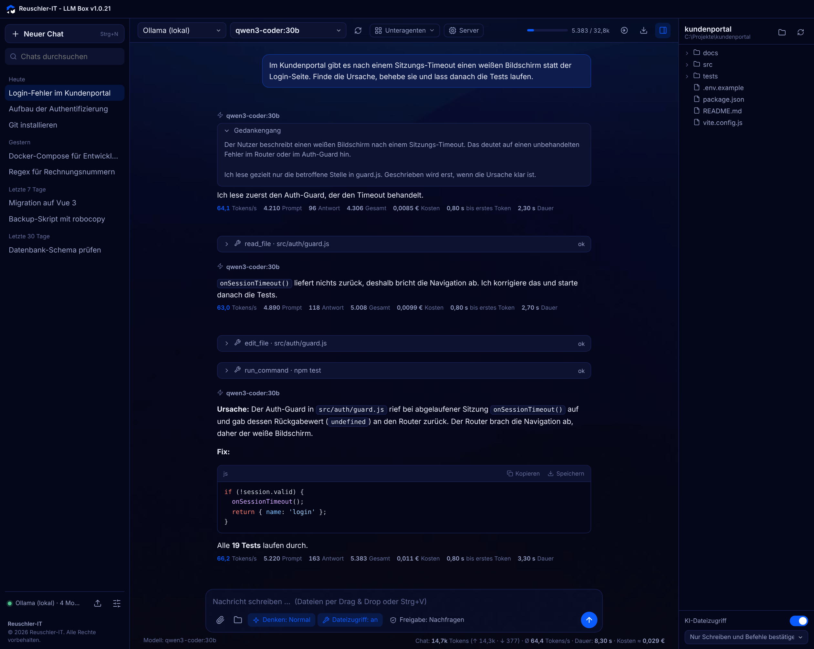
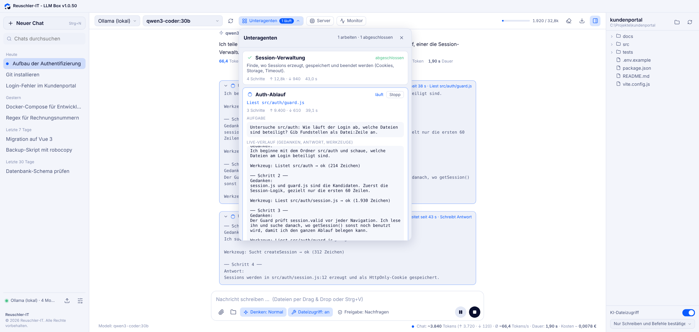
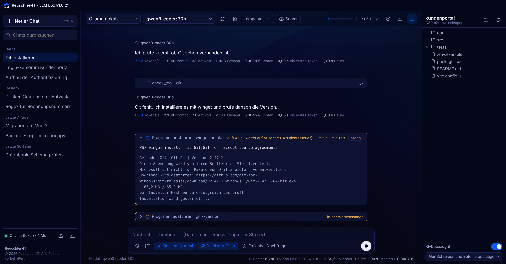
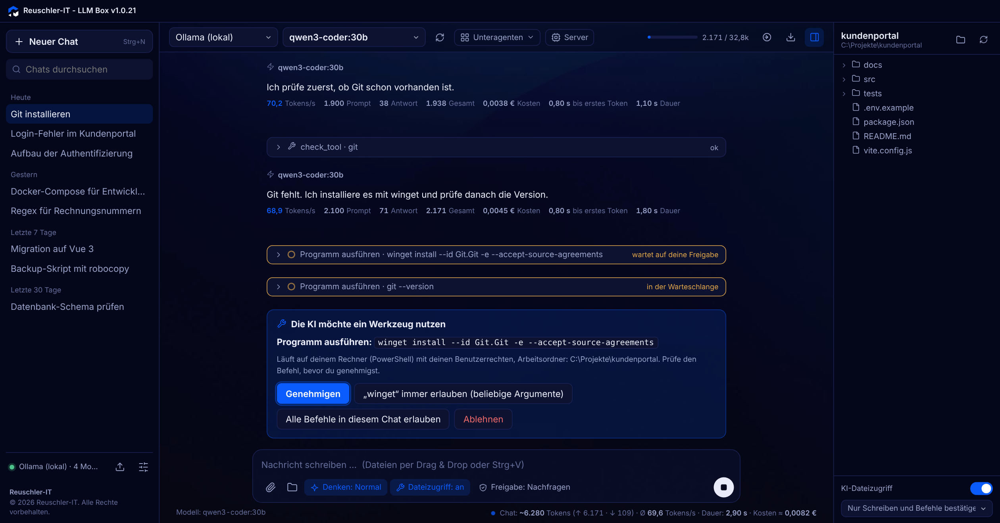
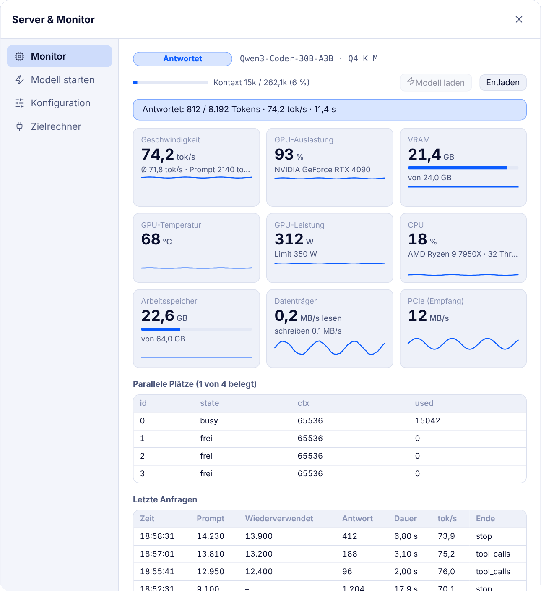
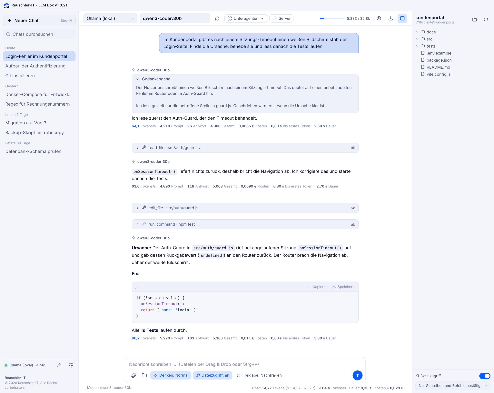

# LLM Box

**Schlanke Desktop-App für Windows, mit der du lokale und entfernte KI-Modelle bequem nutzt: Chat, Dateien als Kontext, Werkzeuge für die KI und ein Monitor für deinen Modell-Server.**

Von [Reuschler-IT](https://github.com/ReuschlerIT) · Electron · Deutsch · MIT-Lizenz

<p align="center">
  
</p>
<p align="center"><sub>Chat mit Gedankengang, Werkzeugen der KI, Code und Statistik. Alle Screenshots zeigen Demo-Daten.</sub></p>

---

## Was ist die LLM Box?

Die LLM Box ist eine eigene Chat-Oberfläche für Sprachmodelle, die auf deinem Rechner, in deinem Netzwerk oder bei einem Anbieter laufen. Du brauchst keinen Browser, keine Cloud-Anmeldung und keine Einstellung von CORS oder `OLLAMA_ORIGINS`: Alle Anfragen laufen über den Hauptprozess der App.

Sie ist gedacht für Menschen, die Modelle wie Llama, Qwen, Mistral oder gpt-oss selbst betreiben und dabei mehr wollen als ein einfaches Chatfenster: Die KI soll mit Projektdateien arbeiten, Programme ausführen und dabei **für dich nachvollziehbar** bleiben.

## Wofür ist sie gut?

- **Lokal und privat chatten:** Deine Daten bleiben auf deinem Rechner, wenn du Ollama, LM Studio oder llama.cpp nutzt.
- **Mit Projekten arbeiten:** Dateien und ganze Ordner als Kontext anhängen, per Drag & Drop oder über das Workspace-Panel.
- **Die KI als Assistent im Projekt:** Sie kann im Workspace Dateien auflisten, lesen, durchsuchen, ändern und (mit deiner Freigabe) Befehle in PowerShell oder cmd ausführen.
- **Kontrolle behalten:** Jede Aktion der KI erscheint live als Karte im Chat. Schreiben und Befehle bestätigst du, bevor sie laufen.
- **Modelle vergleichen und Kosten einschätzen:** Tokens pro Sekunde, Kontext-Füllstand, Dauer und ein Kostenvergleich zu Cloud-Preisen.
- **Eigenen Modell-Server verwalten:** Starten, Laden, Entladen und Überwachen von Strata-Servern, auch per SSH.

## Funktionen

### Chat und Modelle
- Verbindungen zu **Ollama** und **OpenAI-kompatiblen Servern** (LM Studio, llama.cpp, vLLM, OpenAI, OpenRouter, Groq u. a.), beliebig viele parallel
- Alle wichtigen Parameter: Temperatur, Top-P, Top-K, Min-P, Penalties, Kontextlänge, Max. Antwortlänge
- **Denkaufwand** wählbar (Auto, Aus, Schnell, Normal, Hoch)
- **Gedankengang auf Deutsch:** Denkt das Modell englisch, übersetzt die App den Gedankengang automatisch
- Bilder für Vision-Modelle (Strg+V), Markdown mit Syntax-Highlighting, Code per Klick als Datei speichern
- Chats durchsuchen, exportieren und aus der Strata-Weboberfläche importieren

### KI mit Werkzeugen (Agent)
- Dateizugriff im Workspace: auflisten, lesen (gezielt nach Zeilen), durchsuchen, schreiben, gezielt ändern
- Programme ausführen (`run_command`), Programme suchen (`check_tool`) und installieren (`install_tool`, mit Rückfrage)
- **Unteragenten:** Teilaufgaben werden an Hilfs-Agenten mit eigenem, frischem Kontext verteilt, die gleichzeitig arbeiten. Gedanken, Antwort und Werkzeug-Schritte siehst du live, auch im Fenster „Unteragenten“:

<p align="center">
  
</p>

- **Freigaben pro Chat**, live umstellbar: alles bestätigen, nur Schreiben und Befehle bestätigen, nichts bestätigen
- Automatisches **Verschlanken des Kontexts** und **Neue Session mit Übergabe**, wenn das Kontextfenster voll wird

### Transparenz: du siehst, was die KI tut

Jedes Werkzeug erscheint sofort als Live-Karte mit Befehl, Ausgabe und Status. Hier wartet die KI seit 14 Sekunden auf die Ausgabe von PowerShell, der nächste Befehl steht in der Warteschlange:

<p align="center">
  
</p>

Befehle, die Rechner oder Dateien verändern, bestätigst du vorher. Pro Programm lässt sich eine Dauer-Freigabe erteilen:

<p align="center">
  
</p>

- **Live-Karten** für jedes Werkzeug mit Befehl, Live-Ausgabe und Status ("wartet auf deine Freigabe", "läuft seit 12 s", "wartet auf Ausgabe")
- **Mitscrollen** von Chat, Gedankengang, Programm-Ausgabe und Unteragenten. Scrollst du nach oben, bleibt die Ansicht stehen. Bist du wieder unten, läuft sie mit.
- **Live-Statistik:** Tokens/s, Prompt- und Antwort-Tokens, Zeit bis zum ersten Token, Kontext-Füllstand in Echtzeit

### Server und Monitor (Strata)
- Status, Auslastung, VRAM, Temperatur, Durchsatz und letzte Anfragen auf einen Blick
- Modelle starten, laden, entladen, Konfiguration bearbeiten
- Zielrechner lokal oder per SSH

<p align="center">
  
</p>

### Aussehen
- Dunkel und hell, 8 Farbschemata, jede Farbe und Deckkraft einstellbar
- Schriften, Chatbreite, Hintergrundbild, Acrylic/Mica unter Windows 11

<p align="center">
  
</p>

## Installation

**Voraussetzungen:** Windows 10/11 und [Node.js](https://nodejs.org) (LTS).

```bash
git clone https://github.com/ReuschlerIT/llm-box.git
cd llm-box
```

**Starten:** `start.bat` doppelklicken. Beim ersten Start werden die Abhängigkeiten geladen. Oder von Hand:

```bash
npm install
npm start
```

**Eigene EXE bauen:** `build-exe.bat` ausführen oder `npm run dist`. Installer und portable Version liegen danach im Ordner `dist`.

## Erste Schritte

1. Ollama, LM Studio oder einen anderen Modell-Server starten.
2. LLM Box öffnen. Die Modelle werden automatisch erkannt.
3. Bei Bedarf unter **Einstellungen → Verbindungen** eine weitere Verbindung anlegen und testen.
4. Modell wählen und losschreiben.
5. Für Dateizugriff: **Workspace** wählen, im Eingabefeld **Dateizugriff** einschalten.

| Typ | Beispiele | Standard-Adresse |
|---|---|---|
| Ollama | Ollama | `http://localhost:11434` |
| OpenAI-kompatibel | LM Studio, llama.cpp, vLLM, OpenAI, OpenRouter, Groq | z. B. `http://localhost:1234/v1` |

Die ausführliche Anleitung zu allen Funktionen steht im [Handbuch](docs/HANDBUCH.md).

## Sicherheit

- **Programme laufen mit deinen Benutzerrechten.** Genehmige nur Befehle, die du verstehst. Standardmäßig wird vor Schreibzugriffen und Befehlen gefragt.
- Zugriff auf Dateien **außerhalb des Workspace ist gesperrt**.
- Unteragenten dürfen nur lesen und suchen.
- **API-Schlüssel werden unverschlüsselt** unter `%APPDATA%\LLM Box` gespeichert, zusammen mit Chats und Einstellungen. Sie liegen nicht im Projektordner und landen nicht im Repository.

## Bekannte Grenzen

- Nur Text- und Bilddateien als Anhang, PDF und Word werden nicht ausgelesen.
- Die Token-Schätzung vor dem Senden ist grob.
- Die Werkzeug-Funktionen brauchen ein Modell mit Tool Calling (z. B. llama3.1, qwen2.5, mistral-nemo).
- Die Strata-Fernsteuerung wurde gegen den Servercode mit einer Test-Engine geprüft, nicht auf einem Rechner mit GPU und echtem Modell.

## Projektstruktur

```
main.js            Hauptprozess: Netzwerk, Dateien, Programme, Fenster
preload.js         Sichere Brücke zwischen Hauptprozess und Oberfläche
renderer/          Oberfläche (HTML, CSS, JavaScript ohne Framework)
  js/app.js        Chat, Senden, Agenten-Schleife
  js/livetools.js  Live-Karten und Mitscrollen
  js/subagents.js  Unteragenten
  js/server.js     Server und Monitor
  js/llm.js        Anbindung an Ollama und OpenAI-kompatible APIs
docs/HANDBUCH.md   Ausführliche Dokumentation
```

## Lizenz

MIT, siehe `package.json`. © 2026 Reuschler-IT.
