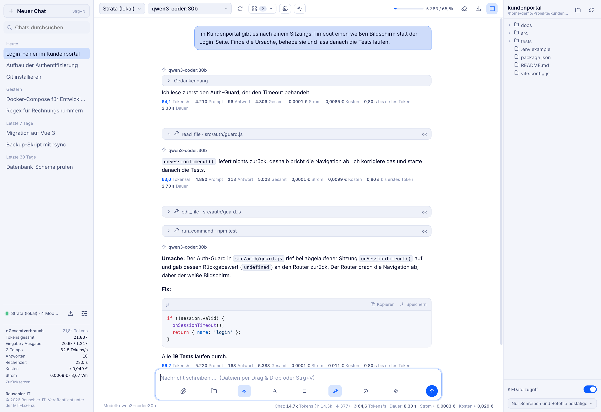
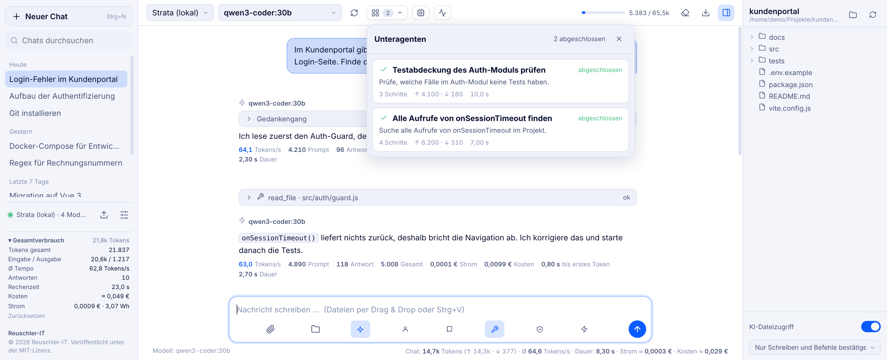
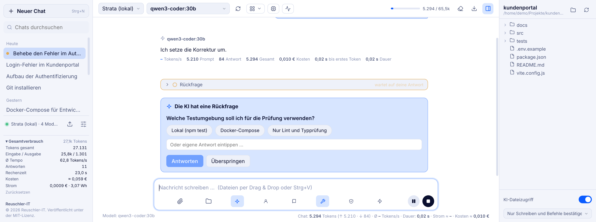
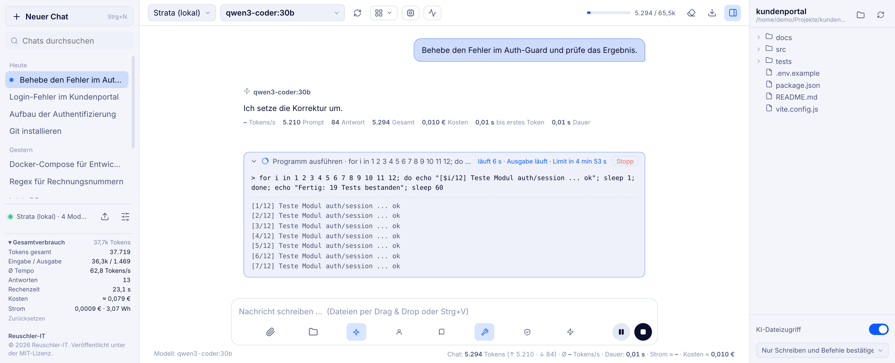
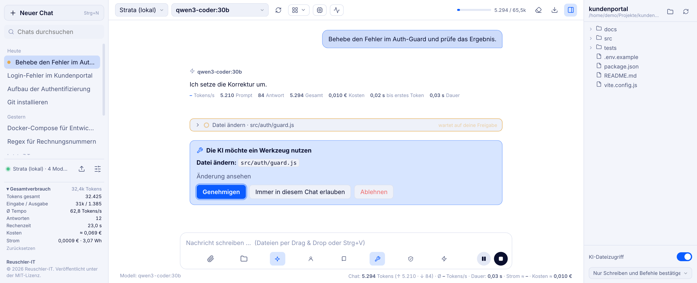
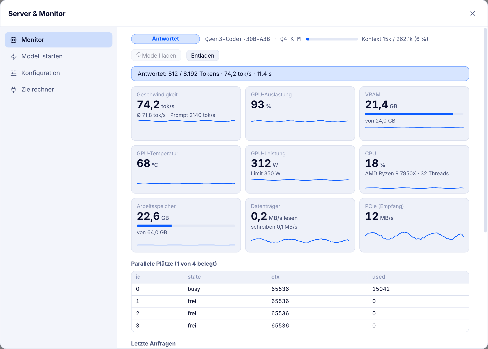
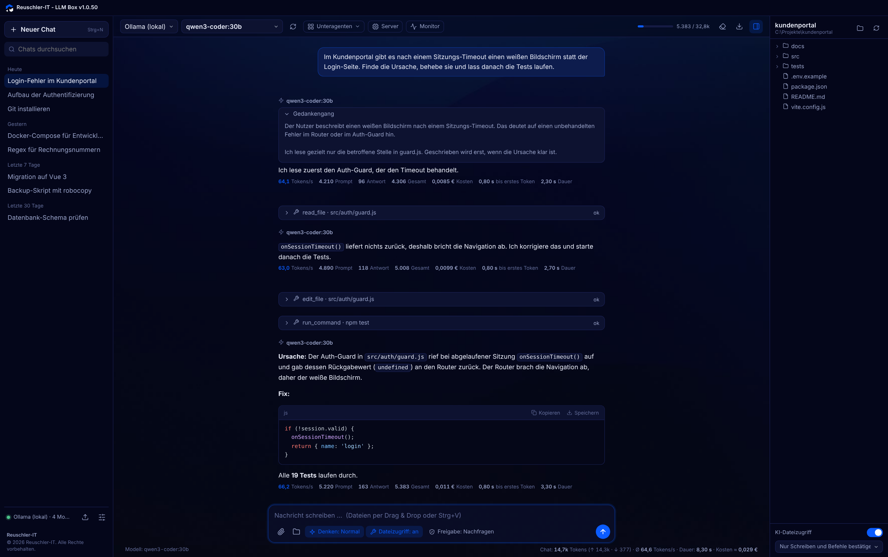

# LLM Box

**Schlanke App für Windows, Linux und Android, mit der du lokale und entfernte KI-Modelle bequem nutzt: Chat, Dateien als Kontext, Werkzeuge für die KI und ein Monitor für deinen Modell-Server.**

Von [Reuschler-IT](https://github.com/ReuschlerIT) · Windows, Linux und Android · Electron · Deutsch · MIT-Lizenz

<p align="center">
  
</p>
<p align="center"><sub>Chat mit Gedankengang, Werkzeugen der KI, Code und Statistik im hellen Standard-Design. Alle Screenshots zeigen Demo-Daten.</sub></p>

---

## Herunterladen

Die fertigen Programme hängen als Dateien am jeweiligen GitHub-Release, nicht mehr im Repository
(die Windows-Programme sind rund 84 MB und gehören nicht in eine Quellcode-Geschichte):

**Aktuelle Version 1.0.86:** [Releases](https://github.com/ReuschlerIT/LLM-Box/releases/tag/1.0.86)

| Datei | Für |
|---|---|
| `LLM.Box.Setup.1.0.86.exe` | Windows 10/11 (Installer) |
| `LLM.Box.1.0.86.portable.exe` | Windows 10/11 (portable, ohne Installation) |
| `LLM-Box-1.0.86-android.apk` | Android 8.0 oder neuer |

Alle drei Programme entstehen aus derselben Quelle. Ältere Versionen stehen unter
[Releases](https://github.com/ReuschlerIT/LLM-Box/releases) (1.0.83, 1.0.82, 1.0.70, 1.0.67, 1.0.65, 1.0.50).

Beide Versionen haben dieselbe Oberfläche und dasselbe Chat-Format, der Austausch zwischen PC und
Handy funktioniert in beide Richtungen (QR-Code, WLAN oder JSON-Datei – siehe unten).

## Was ist die LLM Box?

Die LLM Box ist eine eigene Chat-Oberfläche für Sprachmodelle, die auf deinem Rechner, in deinem Netzwerk oder bei einem Anbieter laufen. Du brauchst keinen Browser, keine Cloud-Anmeldung und keine Einstellung von CORS oder `OLLAMA_ORIGINS`: Alle Anfragen laufen über den Hauptprozess der App.

Sie ist gedacht für Menschen, die Modelle wie Llama, Qwen, Mistral oder gpt-oss selbst betreiben und dabei mehr wollen als ein einfaches Chatfenster: Die KI soll mit Projektdateien arbeiten, Programme ausführen und dabei **für dich nachvollziehbar** bleiben.

## Wofür ist sie gut?

- **Lokal und privat chatten:** Deine Daten bleiben auf deinem Rechner, wenn du Ollama, LM Studio oder llama.cpp nutzt.
- **Mit Projekten arbeiten:** Dateien und ganze Ordner als Kontext anhängen, per Drag & Drop oder über das Workspace-Panel.
- **Die KI als Assistent im Projekt:** Sie kann im Workspace Dateien auflisten, lesen, durchsuchen, ändern und (mit deiner Freigabe) Befehle in PowerShell oder cmd ausführen.
- **Kontrolle behalten:** Jede Aktion der KI erscheint live als Karte im Chat. Schreiben und Befehle bestätigst du, bevor sie laufen.
- **Modelle vergleichen und Kosten einschätzen:** Tokens pro Sekunde, Kontext-Füllstand, Dauer und ein Kostenvergleich zu Cloud-Preisen.
- **Eigenen Modell-Server verwalten:** Starten, Laden, Entladen und Überwachen von Strata-Servern, auch per SSH.

## Funktionen

### Chat und Modelle
- Verbindungen zu **Ollama** und **OpenAI-kompatiblen Servern** (LM Studio, llama.cpp, vLLM, OpenAI, OpenRouter, Groq u. a.), beliebig viele parallel
- Alle wichtigen Parameter: Temperatur, Top-P, Top-K, Min-P, Penalties, Kontextlänge, Max. Antwortlänge. Pro Verbindung lässt sich das Sampling auch **dem Server überlassen**, und unter jeder Antwort zeigt **„Anfrage“**, was genau gesendet wurde. Bei Strata steht neben der App-Messung die vom Server gemessene Geschwindigkeit. Ein eingebauter **Geschwindigkeitstest** (Einstellungen → Verbindungen) vergleicht, ob Sampling, Werkzeuge oder die Füllstand-Abfrage bremsen, und ein **Sparmodus** schont die Grafikkarte, während das Modell antwortet.
- **Denkaufwand** wählbar (Auto, Aus, Schnell, Normal, Hoch)
- **Gedankengang auf Deutsch:** Denkt das Modell englisch, übersetzt die App den Gedankengang automatisch
- **Dokumente und Konfigurationsdateien:** PDF, Word (.docx), Excel (.xlsx), PowerPoint (.pptx) und OpenDocument (.odt/.ods/.odp) werden lokal als Text ausgelesen, als Anhang und von der KI im Workspace. Konfigurationsdateien (.ini, .json, .yaml, .env, .reg …) funktionieren auch in UTF-16 oder mit Windows-Umlauten, beim Ändern bleibt die Kodierung erhalten.
- Bilder für Vision-Modelle (Strg+V), Markdown mit Syntax-Highlighting, Code per Klick als Datei speichern
- **Rechtschreibprüfung** im Eingabefeld: Falsch geschriebene Wörter sind rot wellig unterstrichen, Rechtsklick zeigt Vorschläge (Deutsch und Englisch, in den Einstellungen anpassbar)
- **Bildausgabe:** Modelle, die Bilder erzeugen (z. B. über OpenRouter), liefern sie direkt im Chat. Bilder lassen sich vergrößern, speichern und als Anhang weiterbearbeiten.
- Chats durchsuchen, exportieren und aus der Strata-Weboberfläche importieren

### KI mit Werkzeugen (Agent)
- Dateizugriff im Workspace: auflisten, lesen (gezielt nach Zeilen), durchsuchen, schreiben, gezielt ändern
- Programme ausführen (`run_command`), Programme suchen (`check_tool`) und installieren (`install_tool`, mit Rückfrage)
- **Unteragenten:** Teilaufgaben werden an Hilfs-Agenten mit eigenem, frischem Kontext verteilt, die gleichzeitig arbeiten. Gedanken, Antwort und Werkzeug-Schritte siehst du live, auch im Fenster „Unteragenten“:

<p align="center">
  
</p>

- **Rückfragen mit Antwortvorschlägen:** Fehlen der KI Angaben, stellt sie dir Fragen mit Antworten zum Anklicken (Einzel- oder Mehrfachauswahl, eigene Antwort oder Überspringen möglich):

<p align="center">
  
</p>

- **Freigaben pro Chat**, live umstellbar: alles bestätigen, nur Schreiben und Befehle bestätigen, nichts bestätigen
- Automatisches **Verschlanken des Kontexts**; ist das Fenster voll, bevorzugt die App **Kontext leeren** (derselbe Chat, die KI bekommt eine Übergabe) und bietet alternativ eine **neue Session mit Übergabe** an
- **Pausieren und Fortsetzen** eines laufenden Auftrags: Die KI hält an und macht danach an derselben Stelle weiter

### Transparenz: du siehst, was die KI tut

Jedes Werkzeug erscheint sofort als Live-Karte mit Befehl, Ausgabe und Status. Hier wartet die KI seit 14 Sekunden auf die Ausgabe von PowerShell, der nächste Befehl steht in der Warteschlange:

<p align="center">
  
</p>

Befehle, die Rechner oder Dateien verändern, bestätigst du vorher. Pro Programm lässt sich eine Dauer-Freigabe erteilen:

<p align="center">
  
</p>

- **Live-Karten** für jedes Werkzeug mit Befehl, Live-Ausgabe und Status ("wartet auf deine Freigabe", "läuft seit 12 s", "wartet auf Ausgabe")
- **Mitscrollen** von Chat, Gedankengang, Programm-Ausgabe und Unteragenten. Scrollst du nach oben, bleibt die Ansicht stehen. Bist du wieder unten, läuft sie mit.
- **Live-Statistik:** Tokens/s, Prompt- und Antwort-Tokens, Zeit bis zum ersten Token, Kontext-Füllstand in Echtzeit

### Server und Monitor (Strata)
- Status, Auslastung, VRAM, Temperatur, Durchsatz und letzte Anfragen auf einen Blick
- Modelle starten, laden, entladen, Konfiguration bearbeiten
- Zielrechner lokal oder per SSH

<p align="center">
  
</p>

### Übertragung zwischen PC und Handy

- **Ein QR-Code statt sechs:** Die Windows-App bietet ihre Daten im WLAN an, das Handy holt sie ab – über „Im WLAN suchen" (das Handy findet den Rechner von selbst) oder durch Scannen des einen Codes. Format: `llm-box/docs/TRANSFER-FORMAT.md`.
- **Was übertragen wird:** alle Einstellungen und Verbindungen **inklusive API-Schlüssel**, dazu Modell, Parameter, Darstellung und – wenn ausgewählt – Chats und Textdateien des Workspace. Gerätebezogenes (Fensterposition, Rechner-Kennung) bleibt dagegen auf jedem Gerät.
- **Ohne Netz funktioniert dasselbe als Datei:** QR-Code oder WLAN sind der bequeme Weg; notfalls geht derselbe Inhalt als JSON-Datei, die man auf das andere Gerät kopiert.
- **QR-Code scannen mit der Handy-Kamera:** Die Android-App liest den Code selbst, ohne zusätzliche QR-App. Erkannt wird die Adresse des Angebots ebenso wie eine mehrteilige Bildfolge; fremde Codes werden nur angezeigt, nicht übernommen.
- **Netzwerkordner wandert mit:** Rechner, Freigabe, Unterordner und – falls hinterlegt – die Zugangsdaten einer Windows-Freigabe werden bei der Übertragung mitgegeben. Ein als Laufwerksbuchstabe gemapptes Netzlaufwerk wird dabei automatisch in die echte Freigabe übersetzt.
- **JSON in beide Richtungen:** Derselbe Inhalt als Datei – auch zurück zum PC oder auf ein zweites Handy.
- **Sofort wirksam:** Nach der Übernahme sind Verbindung, Modell und Werkzeuge aktiv; kein Neustart der App nötig.

### Android-App

Die Oberfläche läuft auch auf Android (ab Version 8.0) – als eigene App mit derselben Oberfläche, angepasst für die Touchbedienung:

- Chatliste als Drawer, Knöpfe fingerfreundlich, Auswahlfelder bedarfsgerecht breit
- Chats, Einstellungen und Verbindungen gleiches Format wie am PC
- Netzwerkfreigaben (SMB) direkt als Arbeitsordner nutzbar, ohne Kopieren
- Gebaut wird sie aus diesem Repository (`build-android.ps1`), die fertige APK hängt am GitHub-Release

### Aussehen
- Standard ist das helle Design, dazu ein dunkles Design (unten), 8 Farbschemata, jede Farbe und Deckkraft einstellbar
- Schriften, Chatbreite, Hintergrundbild, Acrylic/Mica unter Windows 11

<p align="center">
  
</p>

## Neu seit Version 1.0.50

Die wichtigsten Änderungen seit 1.0.50 – gruppiert, damit du siehst, was sich für dich ändert.
Der vollständige Verlauf **einzelner Versionen ab 1.0.36** steht in [`llm-box/UPDATE.md`](llm-box/UPDATE.md):

### Chatten und Oberfläche
- **Antwort anhalten und fortsetzen** – die KI macht auf „Fortsetzen" genau dort weiter (ab 1.0.50)
- **„Kontext leeren"** – Übergabe-Text wird eingefügt, der bisherige Verlauf bleibt erhalten (ab 1.0.50)
- **Chat wechseln, während die KI noch schreibt** – die Antwort läuft im Hintergrund weiter (ab 1.0.50)
- **Nachricht vormerken**, während die KI antwortet (ab 1.0.50)
- **Enter ist standardmäßig eine neue Zeile**; Senden mit Enter lässt sich in den Einstellungen wieder einschalten (bis 1.0.54)
- **Helle Oberfläche ist Standard** (ab 1.0.50)
- Statuszeile unter dem Eingabefeld zeigt Chat, Dauer und Kosten vollständig, ohne Abschneiden (bis 1.0.54)

### Große Chats deutlich schneller
- Sehr lange Chate baut die App **fensterweise** auf: es werden nur die sichtbaren Nachrichten aufgebaut. Gemessen an einem echten Chat mit 3487 Nachrichten bleiben konstant rund 2700 Knoten im Aufbau – das vorherige Zögern beim Scrollen ist damit weg (ab 1.0.59)
- Gesperrte Chat-Metadaten gelten nicht mehr als „gelöscht": Chats verschwinden nicht mehr und die Liste wird nicht grundlos komplett neu aufgebaut (ab 1.0.58)

### Dateien, Workspace und Netzwerkordner
- **Windows-Freigabe als Arbeitsordner:** ein Netzlaufwerk direkt nutzen, nichts wird kopiert; mit Verbindungstest und Übernahme der Zugangsdaten (ab 1.0.61 am PC, auf dem Handy schon früher)
- **Gemapptes Netzlaufwerk wird erkannt:** ein als Laufwerksbuchstabe eingebundenes Netzlaufwerk wird bei der Übertragung automatisch in die dahinterliegende Freigabe übersetzt – vorher ging auf diesem Weg kein Netzwerkordner mit (am PC ab 1.0.63, auf dem Handy ab 1.0.63-/1.0.64-android)
- Große Dateien über 20 MB werden mit klarer Meldung abgelehnt statt die App abstürzen zu lassen; fehlgeschlagene Speichervorgänge hinterlassen keine Restdateien (bis 1.0.54)

### Übertragung zwischen PC und Handy
- **Ein QR-Code statt sechs:** Daten werden im WLAN angeboten, das andere Gerät sucht sie (bis 1.0.54)
- **Handy kann QR-Codes selbst scannen** – mit der Kamera, ohne fremde QR-App; Adresse und mehrteilige Bildfolge werden erkannt, fremde Codes abgewiesen (ab 1.0.62)
- **Netzwerkordner samt Zugangsdaten wandert mit** (ab 1.0.61)
- Nach der Übernahme sind Verbindung, Modell und Werkzeuge sofort wirksam – kein App-Neustart (ab 1.0.55)
- Der PC schaltet sein Angebot nach dem Abruf wieder ab; „Im WLAN anbieten" ist mehrfach hintereinander nutzbar (ab 1.0.56)

### Chats auf mehreren Geräten
- **Gemeinsamer Chat-Ordner** inklusive Windows-Freigabe, mit Konflikt-Schutz: fremde Fassungen werden nie überschrieben, sondern als „(Konflikt …)"-Kopie angelegt (ab 1.0.50)
- **Neue Einstellung „Chats abgleichen alle …"** von Echtzeit bis 30 Minuten, ohne Neustart wirksam (ab 1.0.57)
- Beim Zurückkehren ins Fenster wird sofort abgeglichen; ein doppelter Unterordner beim Einrichten wird automatisch bereinigt (bis 1.0.54)

### Sprache: Deutsch, English, Français (ab 1.0.66)
- **Die ganze Oberfläche ist übersetzt** – Beschriftungen, Knöpfe, Hilfetexte, Dialoge, Statuszeile, Tooltips, Fehlermeldungen, Server-Fenster und Platzhalter (Wörterbuch mit 1.063 Einträgen und 156 Mustern). Die KI antwortet in derselben Sprache; Chat-Inhalt wird nie übersetzt
- **Sprachabfrage beim allerersten Start** – dreisprachiger Dialog, der die Systemsprache vorschlägt und dessen Wahl sofort für Oberfläche, Antwortsprache und Standard-Prompt gilt (ab 1.0.67)
- **Später umschaltbar** unter *Einstellungen → Darstellung → Sprache der App* (ab 1.0.67)

### Modellprofil für kleine, stark quantisierte Modelle (ab 1.0.66)
- **Neues Profil „Kleines / stark quantisiertes Modell (IQ3/Q3)"** – kurzer System-Prompt und kurze Werkzeugbeschreibungen, rund 2.500 statt 4.000 Tokens je Anfrage; Standard für neue Installationen
- **Neue Einstellung „Arbeitskontext-Obergrenze (Tokens)"** und ein Knopf „Standard-Prompt wiederherstellen"
- **Weniger vorzeitige Abbrüche im Werkzeugmodus** – der wirksame Arbeitskontext statt des großen Server-Fensters entscheidet über Komprimierung und Übergabe (ab 1.0.66)

### Claude-Anbindung (ab 1.0.68)
- **Verbindungstyp „Anthropic (Claude)"** unter *Einstellungen → Verbindungen* mit API-Schlüssel,
  Basis-Adresse `https://api.anthropic.com/v1`, Modellliste und Eingabe-Limit vom Anbieter
- **Denken wählbar:** „Adaptiv + effort" (Standard) oder festes Token-Budget für ältere Modelle
- **Prompt-Caching** auf System-Prompt, Werkzeugen und letztem Verlauf, abschaltbar
- Lückenhafte Werkzeug-Verläufe werden vor dem Senden repariert; eigene Diagnose mit Testanfrage
  von höchstens 16 Token und deutlichen Meldungen für 401, 429, 529 und fehlendes Guthaben

### Stromverbrauch (ab 1.0.70)
- **Neue Einstellung „Strompreis (€ je kWh)"** unter *Einstellungen → Kosten*
- **GPU-Leistung des überwachten Servers wird gemessen** und je Anfrage aufsummiert; die Statuszeile
  zeigt „Strom ≈ … €" neben Tokens, Dauer und Kosten, die Statistik die Kosten dieser Antwort
- Ohne erreichbaren Monitor oder ohne `gpu_power` des Server-Monitors bleibt die Angabe „–"

### Hinweise an die laufende KI (ab 1.0.70)
- **Eingabe während einer Antwort** wird als Hinweis an den laufenden Auftrag gestellt und nach dem
  aktuellen Schritt zugestellt – der Knopf **„Jetzt"** unterbricht die Antwort und stellt sofort zu
- Nicht zugestellte Hinweise kommen zurück ins Eingabefeld, Kennzeichnung „Hinweis während der Arbeit"
- **Mehrere Aufträge pro Chat:** jeder Auftrag hat eigene Fortschritts-, Live- und Werkzeugkarten;
  Unteragenten gehören zum Chat, Werkzeugkarten zum Auftrag

### Live-Ansicht und Hub: Chats auf allen Geräten (ab 1.0.72/1.0.74)
- **Live-Ansicht:** Die Windows-App bietet ihre Chats im WLAN an, ein zweites Gerät (Windows oder
  Android per QR-Code) zeigt sie Wort für Wort, schreibgeschützt; mit „Fernsteuerung erlauben" darf
  das zweite Gerät auch senden und stoppen (ab 1.0.72)
- **LLM Box Hub** (Ordner `hub/`): Server ohne Oberfläche für Linux und Windows (Node.js 18+, keine
  Pakete). Er speichert die Chats, ruft Modelle auf (Strata lokal oder Cloud – die Schlüssel liegen
  nur auf dem Hub) und verteilt alles in Echtzeit. Die Antwort läuft auf dem Hub weiter, auch wenn
  Gerät oder App zu sind (ab 1.0.74)
- Chatliste mit Modellauswahl, Umbenennen, Löschen und „+ Neuer Chat auf …" in der Seitenleiste;
  Protokoll in `llm-box/docs/LIVE-ANSICHT.md`, Anleitung in `llm-box/hub/README.md` und in `UPDATE.md`

### Module im Stil von Open WebUI (ab 1.0.73)
- **Funktionen & Ansicht:** jede Funktion einzeln ein-/ausschaltbar, Profile „Schlicht", „Standard", „Alles"
- **Prompt-Bibliothek** mit „/"-Befehlen, **Assistenten** (Rolle, Modell, Temperatur), **Gedächtnis**
  (`/merke`), **Wissenssammlungen** (lokale Suche), **Vorlesen**, **Chats ordnen** (anheften, archivieren, Tags)

### Websuche ohne eigenen Server (ab 1.0.77/1.0.78)
- Suchanbieter **DuckDuckGo** (ohne Konto), **Brave Search**, **Wikipedia**, **Tavily**, **Serper**, **Exa**
  und optional **SearXNG** – die Suche läuft direkt auf dem Rechner der App
- Ab 1.0.82 lässt sich **SearXNG als Hintergrunddienst mit der App starten** (per Docker oder eigenem
  Startbefehl), inklusive Knöpfen Starten/Stoppen/Status prüfen

### Autonomer Modus (ab 1.0.80)
- Die KI arbeitet vollständig selbstständig, auch über Nacht: keine Rückfragen, keine Freigaben,
  Kontext leert sich selbst, Weitermachen bis zum Ergebnis (`finish_task`), Höchstdauer und
  Werkzeug-Grenzen einstellbar, gefährliche Befehle werden blockiert
- Ab 1.0.81 prüft sie vor dem Abschluss einmal selbst ihr Ergebnis („Abschluss einmal prüfen lassen")

### Neu in 1.0.84 bis 1.0.86
- **MCP-Server (1.0.86):** Die Box ist jetzt ein MCP-Client. Beliebig viele Server gleichzeitig –
  lokale Programme per stdio und Web-Adressen per Streamable HTTP. Werkzeuge heißen für das Modell
  `mcp__<server>__<werkzeug>`, sind einzeln an-/abschaltbar und werden standardmäßig pro Aufruf
  freigegeben. Import im Claude-Desktop-Format, Vorlagen für REA. Kontextschutz: Obergrenze pro
  Anfrage, gekürzte Ergebnisse, Zeitlimit.
- **Einstellungen neu geordnet (1.0.84):** aus 14 Reitern werden 8 nach Zweck (Verbindung, KI,
  Arbeit, App), jeder mit aufklappbaren Abschnitten, plus Suche über alle Einstellungen.
- **Projekte je Chat (1.0.84):** der Workspace-Ordner ist die Wurzel, jeder Chat arbeitet in einem
  eigenen Projekt (Unterordner); die KI sieht nur ihr Projekt. `PROJEKT.md` als Projektanweisung.
- **Genauigkeit und Tempo (1.0.84):** Temperatur bei Dateiarbeit begrenzt, Datei-nicht-gefunden
  hängt die vorhandenen Dateien an, drei Sampling-Schnellwahlen. Skills mit schrittweiser
  Offenlegung (Werkzeug `use_skill`). Strata-Startformular mit Startprofilen und Start-Skript.
- **Lange eingefügte Texte (1.0.85):** besteht eine Nachricht nur aus eingefügtem Text, wird sie als
  Auftrag gesendet statt als Datei – die KI stellt keine Gegenfrage mehr.
- Neue englische und französische Texte (`i18n-lex-v84.js`, `i18n-lex-v86.js`).

### Neu in 1.0.83
- **Modellprofil „Kleines / stark quantisiertes Modell" (IQ3/Q3) nachgereicht:** Sampling nach der
  Qwen-Empfehlung für den Denkmodus (Temperatur 1,0, Top-P 0,95, Top-K 20, Min-P 0), Max. Antwortlänge
  32768, Denkaufwand „Niedrig" als Standard. Gegen Denkschleifen und abgeschnittene Antworten.
  Bestehende Installationen werden einmalig umgestellt (eigene Eingaben bleiben).
- **System-Prompt gestrafft:** keine erzwungene Denksprache mehr (nur noch der eigene Schalter),
  dazu „kurz planen, dann handeln", „nicht im Kreis denken", „nichts erfinden, erst lesen".
- **Strata: Entwurfs-Verfahren** (`--drafting`) und Entwurfs-Fenster (spec) unter *Modell starten*,
  plus ein Knopf für empfohlene Engine-Werte.
- Neue englische und französische Texte (`i18n-lex-v83.js`).

### Neu in 1.0.82
- **Feste Reihenfolge der Chatliste** (nach Erstellung, neuester oben) – laufende Chats springen nicht mehr
- **Denken und Dateizugriff pro Chat** statt global
- **Gesamtverbrauch** in der Seitenleiste: Tokens, Tempo, Antworten, Rechenzeit, Kosten und Strom über
  alle Chats, bleibt auch nach dem Löschen erhalten (`usage.json`), mit „Zurücksetzen"
- **Rund 290 neue englische und französische Texte**; Anweisungen an die KI gehen in der App-Sprache hinaus
- **Linux-Fassung**: Start über `start.sh`/`build-linux.sh`, Pakete über `npm run dist:linux`
  (AppImage, deb, tar.gz), Anleitung in `llm-box/docs/LINUX.md`

### Werkzeuge der KI
- **Laufende Workspace-Suchen wirklich abbrechen** – inklusive Meldung, wie viele Dateien geprüft wurden (ab 1.0.50)
- **Rechtschreibprüfung ein-/ausschaltbar**, auf dem Handy direkt am Eingabefeld (ab 1.0.50)
- „Max. Werkzeug-Schritte am Stück" (Standard 25) auch in der Android-Oberfläche sichtbar (bis 1.0.54)

### Oberfläche und Bedienung auf dem Handy
- Obere Leiste passt wieder in eine Reihe; Modellname wird nicht mehr abgeschnitten (bis 1.0.54)
- Chat-Aktionen (Umbenennen, Löschen) sind dauerhaft sichtbar und gut treffbar – kein Maus-Hover nötig (bis 1.0.54)
- Kein weißer Block mehr beim Start der Handy-App – behoben schon vor der ersten Handy-Version mit richtiger Nummer (die App trug lange eine veraltete Versionsnummer, erst ab 1.0.59-android stimmen Nummern und Inhalt überein)
- Einheitliche Kopfzeile ohne den Knopf „Modelle neu laden" – Modelle werden beim Start, bei Verbindungswechsel und beim Schließen der Einstellungen ohnehin neu geladen (ab 1.0.65-android)

### Fehlerbehebungen (Auswahl)
- **Kein Einfrieren der Oberfläche** mehr bei langsamen oder abgebrochenen Netzwerkzugriffen: Datei- und Freigabezugriffe laufen im Hintergrund – gemessen bei einem 10-Sekunden-Zugriff, die Oberfläche blieb voll bedienbar (bis 1.0.54)
- Schwarze Kamera-Vorschau auf manchen Handys behoben (Wiedergaberegels der App, nicht die Berechtigung) (ab 1.0.64-android)
- Abbrechen eines Scans gibt die Kamera wieder frei; der Scan-Knopf bleibt nicht dauerhaft ausgegraut (ab 1.0.64-android)
- Paralleles Speichern von Chats schlug fehl (gemeinsame Temporärdatei); Umbenennen auf Freigaben scheiterte – beides behoben (bis 1.0.54)

## Installation

**Voraussetzungen:** Windows 10/11 und [Node.js](https://nodejs.org) (LTS).

```bash
git clone https://github.com/ReuschlerIT/llm-box.git
cd llm-box
```

**Starten:** `start.bat` doppelklicken. Beim ersten Start werden die Abhängigkeiten geladen. Oder von Hand:

```bash
npm install
npm start
```

**Eigene EXE bauen:** `build-exe.bat` ausführen. Das Skript zeigt die aktuelle Version aus `package.json` und fragt nach der Version für diesen Build (Enter behält sie). Direkt geht auch `build-exe.bat 1.0.25`. Installer und portable Version liegen danach im Ordner `dist`, die Versionsnummer steht im Dateinamen. Wer ohne das Skript baut (`npm run dist`), muss `version` in `package.json` selbst anpassen.

## Erste Schritte

1. Ollama, LM Studio oder einen anderen Modell-Server starten.
2. LLM Box öffnen. Die Modelle werden automatisch erkannt.
3. Bei Bedarf unter **Einstellungen → Verbindungen** eine weitere Verbindung anlegen und testen.
4. Modell wählen und losschreiben.
5. Für Dateizugriff: **Workspace** wählen, im Eingabefeld **Dateizugriff** einschalten.

| Typ | Beispiele | Standard-Adresse |
|---|---|---|
| Ollama | Ollama | `http://localhost:11434` |
| OpenAI-kompatibel | LM Studio, llama.cpp, vLLM, OpenAI, OpenRouter, Groq | z. B. `http://localhost:1234/v1` |

Die ausführliche Anleitung zu allen Funktionen steht im [Handbuch](llm-box/docs/HANDBUCH.md).

## Sicherheit

- **Programme laufen mit deinen Benutzerrechten.** Genehmige nur Befehle, die du verstehst. Standardmäßig wird vor Schreibzugriffen und Befehlen gefragt.
- Zugriff auf Dateien **außerhalb des Workspace ist gesperrt**.
- Unteragenten dürfen nur lesen und suchen.
- **API-Schlüssel werden unverschlüsselt** unter `%APPDATA%\LLM Box` gespeichert, zusammen mit Chats und Einstellungen. Sie liegen nicht im Projektordner und landen nicht im Repository.

## Bekannte Grenzen

- Dokumente werden nur gelesen, nicht geschrieben: Die KI kann keine .docx/.xlsx/.pdf erzeugen oder ändern (sie kann aber .csv, .md, .html schreiben oder per Skript arbeiten). Gescannte PDFs ohne Text (OCR) und alte Formate (.doc, .xls, .ppt) werden nicht gelesen.
- Die Token-Schätzung vor dem Senden ist grob.
- Bildausgabe funktioniert über OpenAI-kompatible Chat-Schnittstellen (z. B. OpenRouter). Reine Bild-Endpunkte (`/images/generations`) und Ollama-Bildmodelle werden noch nicht unterstützt.
- Die Werkzeug-Funktionen brauchen ein Modell mit Tool Calling (z. B. llama3.1, qwen2.5, mistral-nemo).
- Die Strata-Fernsteuerung wurde gegen den Servercode mit einer Test-Engine geprüft, nicht auf einem Rechner mit GPU und echtem Modell.

## Projektstruktur

```
README.md                diese Beschreibung
llm-box/                 Windows-App (Electron)
  main.js                  Hauptprozess: Netzwerk, Dateien, Programme, Fenster
  preload.js               Sichere Brücke zwischen Hauptprozess und Oberfläche
  renderer/                Oberfläche (HTML, CSS, JavaScript ohne Framework)
    js/app.js              Chat, Senden, Agenten-Schleife
    js/livetools.js        Live-Karten und Mitscrollen
    js/subagents.js        Unteragenten
    js/server.js           Server und Monitor
    js/llm.js              Anbindung an Ollama, OpenAI-kompatible APIs und Anthropic
    js/transfer.js         Übertragung zwischen PC und Handy
    js/live.js             Live-Ansicht (Quelle und Empfänger)
    js/modules.js          Funktionen & Ansicht, Wissenssuche, Websuche
    js/owui.js             Prompt-Bibliothek, Assistenten, Gedächtnis, Vorlesen, Chats ordnen
    js/auto.js             Autonomer Modus
    js/usage.js            Gesamtverbrauch in der Seitenleiste
    js/handoff.js          Kontext leeren und neue Session mit Übergabe
    vendor/qrcode.js       QR-Code-Erzeugung (qrcode-generator 1.4.4, MIT)
  hub/                     LLM Box Hub: Server ohne Oberfläche (Linux und Windows)
  docs/HANDBUCH.md         Ausführliche Dokumentation
  docs/TRANSFER-FORMAT.md  Format der Übertragung (für die Android-Seite)
  docs/LIVE-ANSICHT.md     Protokoll der Live-Ansicht und des Hub
  docs/LINUX.md            Linux-Fassung starten und bauen
  UPDATE.md                Änderungen pro Version (ab 1.0.36)
android/                 Android-App (Java, WebView) – gebaut mit build-android.ps1
tools-android/           Portierungshelfer und Prüfläufe
webdeps/                 Web-Bausteine für die Android-Oberfläche
```

Die fertigen Programmdateien (Setup, portable EXE, APK) liegen nicht im Repository, sondern als
Dateien am GitHub-Release der jeweiligen Version.

## Lizenz

MIT, siehe [`LICENSE`](LICENSE). © 2026 Reuschler-IT. Die Lizenzen der enthaltenen
Open-Source-Bausteine (marked, DOMPurify, highlight.js, pdf.js, Electron u. a.) stehen in
[`THIRD-PARTY-NOTICES.md`](THIRD-PARTY-NOTICES.md).
