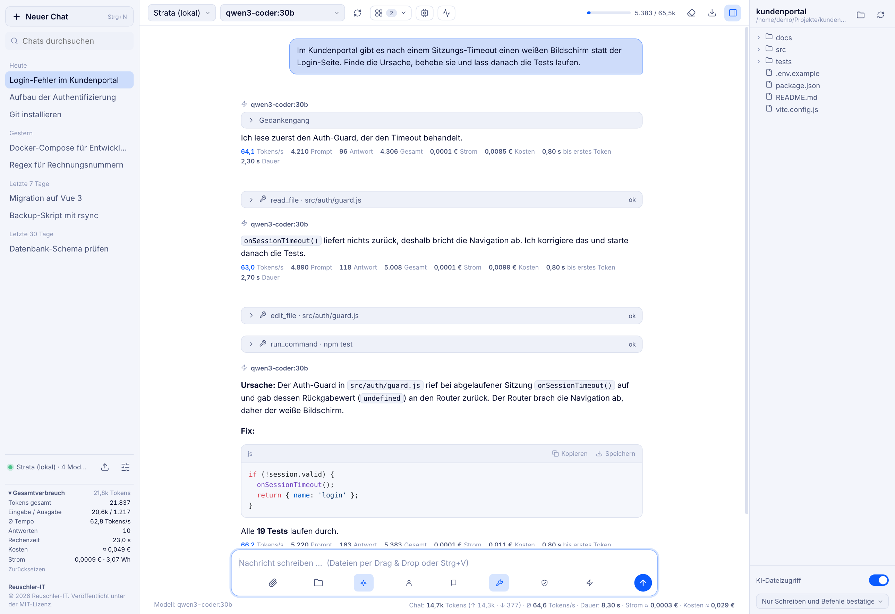
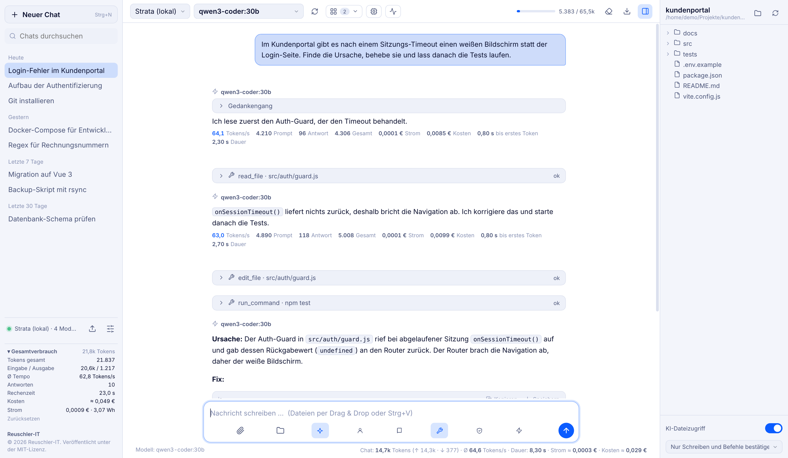
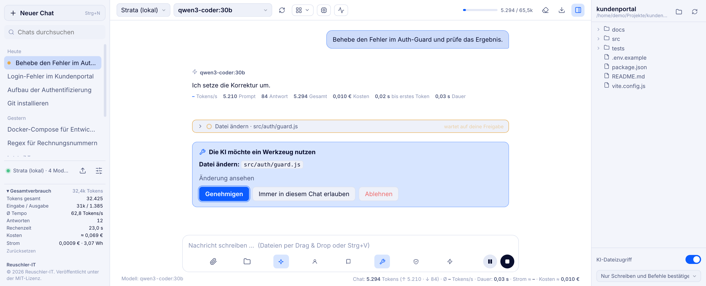
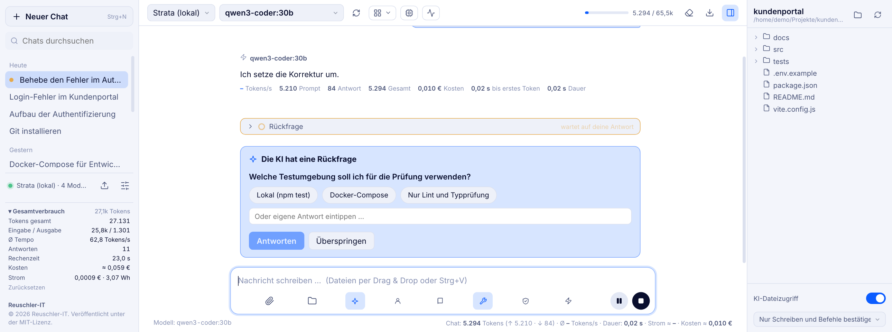
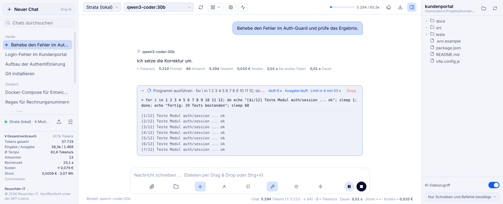
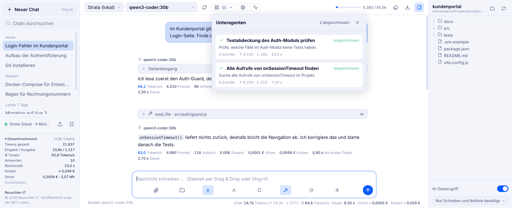
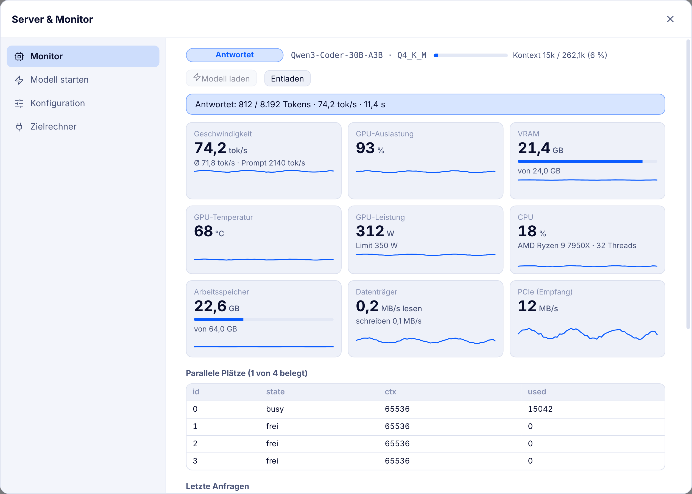
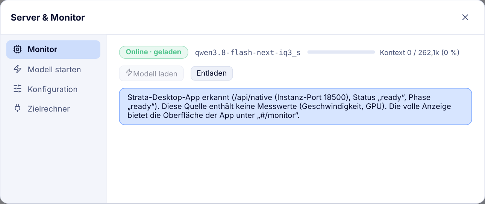

# LLM Box – Windows-App (Electron)

Dieser Ordner enthält den Quelltext der **Desktop-Fassung**. Die vollständige
Projektbeschreibung, alle Funktionen und die Anleitung stehen eine Ebene höher in
[`../README.md`](../README.md), die ausführliche Dokumentation in
[`docs/HANDBUCH.md`](docs/HANDBUCH.md), die Änderungen jeder einzelnen Version seit 1.0.36
in [`UPDATE.md`](UPDATE.md).

## Starten

```
npm install
npm start
```

## Eigene Programmdatei bauen

```
npm run dist
```

Das Ergebnis liegt anschließend in `dist/` (Installer und portable EXE). Die fertigen,
geprüften Programmdateien für diese Veröffentlichung liegen im Ordner [`../download/`](../download/).

## Android-Fassung

Die Android-App wird aus dem übergeordneten Ordner gebaut (`build-android.ps1`) und teilt sich
die Oberfläche mit dieser Desktop-Fassung. Das Format der Übertragung zwischen beiden
Programmen ist in [`docs/TRANSFER-FORMAT.md`](docs/TRANSFER-FORMAT.md) beschrieben.

## Hub (Server ohne Oberfläche)

Im Ordner [`hub/`](hub/) liegt der **LLM Box Hub**: Chats, Modellaufrufe und Echtzeit-Anzeige auf einem Linux- oder Windows-Server (Anleitung: [`hub/README.md`](hub/README.md), Protokoll: [`docs/LIVE-ANSICHT.md`](docs/LIVE-ANSICHT.md)).

## Screenshots (helles Design, Version 1.0.82)

Chat mit Werkzeugen, Dateibaum und Gesamtverbrauch (links unten):



Gesamtansicht im hellen Design:



Freigabe: Die KI fragt, bevor sie eine Datei ändert.



Rückfrage der KI mit Antwortvorschlägen:



Programmausgabe live im Chat, mit Stopp-Knopf und Zeitlimit:



Unteragenten: Wer arbeitet woran.



Server & Monitor mit GPU, VRAM, Leistung und letzten Anfragen:



Strata-Desktop-App im Monitor:



> Die Bilder zeigen Beispieldaten (ein Beispielprojekt „kundenportal“ und einen Test-Modellserver), keine echten Chats.

## Lizenz

LLM Box steht unter der **MIT-Lizenz**, siehe [`LICENSE`](LICENSE). © 2026 Reuschler-IT.

## Verwendete Projekte und Bezug zu anderen Repositories

**Im Quelltext bzw. in der App enthalten** (jeweils mit eigener Lizenz, Texte in [`THIRD-PARTY-NOTICES.md`](THIRD-PARTY-NOTICES.md)):

- [marked](https://github.com/markedjs/marked) (MIT): Markdown
- [DOMPurify](https://github.com/cure53/DOMPurify) (Apache-2.0 oder MPL-2.0): HTML säubern
- [highlight.js](https://github.com/highlightjs/highlight.js) (BSD-3-Clause): Syntaxfärbung
- [qrcode-generator](https://github.com/kazuhikoarase/qrcode-generator) (MIT): QR-Codes
- [fast-xml-parser](https://github.com/NaturalIntelligence/fast-xml-parser) (MIT) und [JSZip](https://github.com/Stuk/jszip) (MIT oder GPL-3.0-or-later): Office-Dokumente lesen
- [pdf.js](https://github.com/mozilla/pdf.js) (Apache-2.0): PDF lesen
- [Electron](https://github.com/electron/electron) (MIT) und [electron-builder](https://github.com/electron-userland/electron-builder) (MIT): Laufzeit und Build
- Android-Fassung: [jsQR](https://github.com/cozmo/jsQR) (Apache-2.0)

**Nur angesprochen oder als Vorbild genutzt, nicht enthalten:**

- [Strata](https://github.com/Niko1221/Strata) (MIT): lokaler Modell-Server, den LLM Box bedient und überwacht
- [llama.cpp](https://github.com/ggml-org/llama.cpp) und [Ollama](https://github.com/ollama/ollama) (jeweils MIT), LM Studio: kompatible Schnittstellen
- Websuche als Dienste (eigener Schlüssel nötig, außer DuckDuckGo/Wikipedia): [Tavily](https://tavily.com), [Serper](https://serper.dev), [Brave Search API](https://brave.com/search/api/), [Exa](https://exa.ai), [DuckDuckGo](https://duckduckgo.com), [Wikipedia](https://www.wikipedia.org), optional [SearXNG](https://github.com/searxng/searxng) (AGPL-3.0) über einen selbst betriebenen Server
- [Open WebUI](https://github.com/open-webui/open-webui): Vorbild für Funktionsumfang und Live-Ansicht, kein Quelltext übernommen
